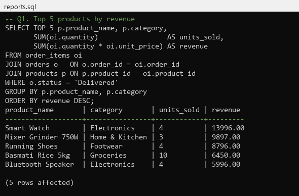
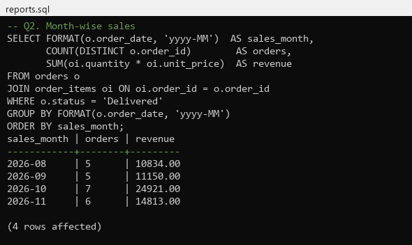
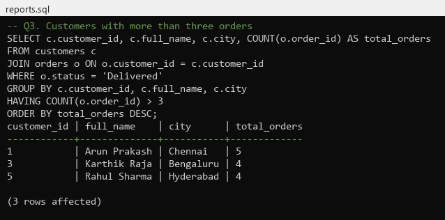
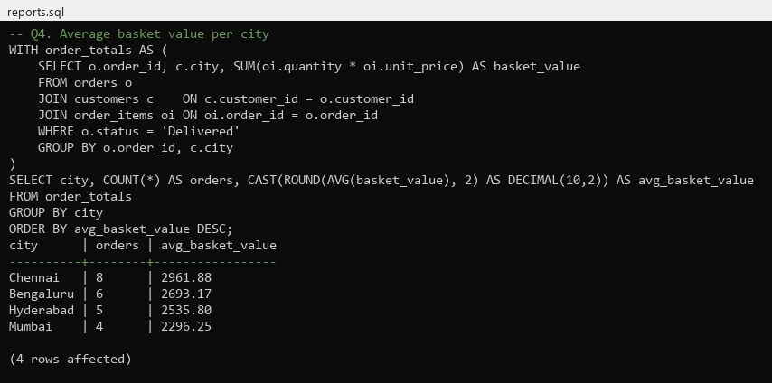
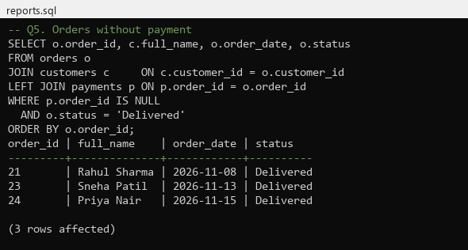
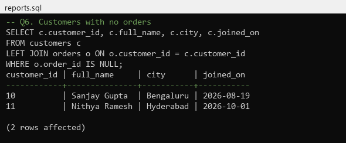
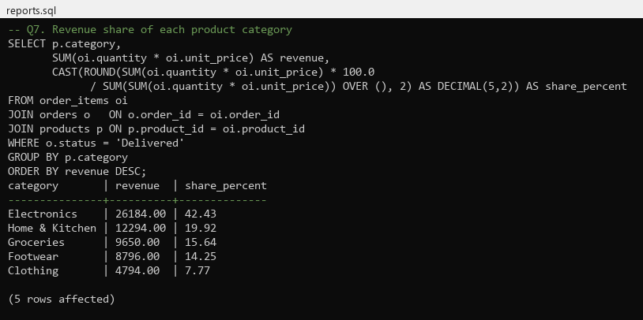
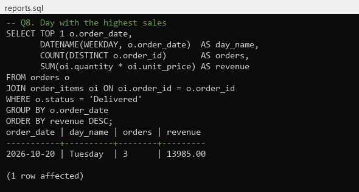

# Task 1 – Report Queries

Revenue = quantity × unit price of delivered orders (the one cancelled order is left out).

| Query | Report |
|---|---|
| [Q1_top5_products_by_revenue.sql](Q1_top5_products_by_revenue.sql) | Top 5 products by revenue |
| [Q2_month_wise_sales.sql](Q2_month_wise_sales.sql) | Month-wise sales |
| [Q3_customers_more_than_3_orders.sql](Q3_customers_more_than_3_orders.sql) | Customers with more than three orders (HAVING) |
| [Q4_avg_basket_value_per_city.sql](Q4_avg_basket_value_per_city.sql) | Average basket value per city |
| [Q5_orders_without_payment.sql](Q5_orders_without_payment.sql) | Orders without payment (LEFT JOIN) |
| [Q6_customers_with_no_orders.sql](Q6_customers_with_no_orders.sql) | Customers with no orders |
| [Q7_category_revenue_share.sql](Q7_category_revenue_share.sql) | Product-category revenue share |
| [Q8_highest_sales_day.sql](Q8_highest_sales_day.sql) | Day with the highest sales |

## Output

**Q1. Top 5 products by revenue**

**Q2. Month-wise sales**

**Q3. Customers with more than three orders (HAVING)**

**Q4. Average basket value per city**

**Q5. Orders without payment (LEFT JOIN)**

**Q6. Customers with no orders**

**Q7. Product-category revenue share**

**Q8. Day with the highest sales**

