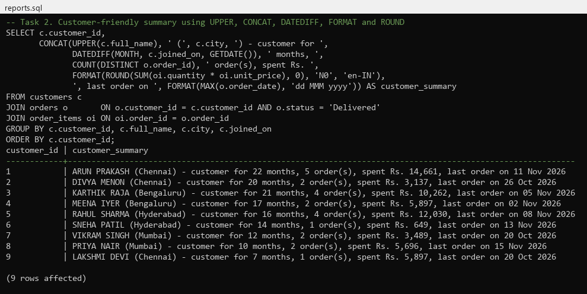
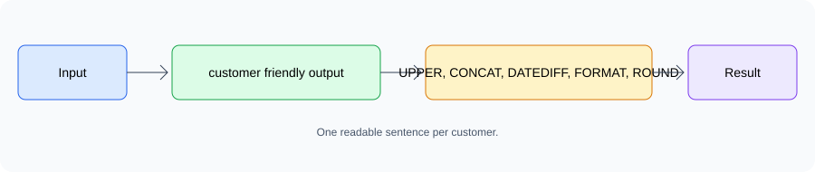

# Question 2 – Customer-friendly output (UPPER, CONCAT, DATEDIFF, FORMAT, ROUND)

One readable sentence per customer: UPPER for the name, CONCAT to join the parts, DATEDIFF for months since joining, ROUND and FORMAT for the amount (Indian comma style) and FORMAT for the last order date. Expected: 9 rows.

## Query files

- [customer_summary.sql](customer_summary.sql)

## Output

Full text output: [output.txt](output.txt)

## Approach

