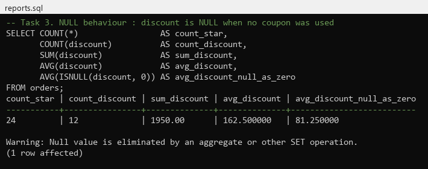
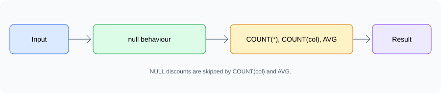

# Question 3 – NULL behaviour in COUNT(*), COUNT(column) and AVG

`discount` is NULL when no coupon was used (24 orders, 12 with a discount value).

- `COUNT(*)` counts every row: **24**.
- `COUNT(discount)` skips NULLs: **12** (a 0 is still counted).
- `AVG(discount)` also skips NULLs: 1950 / 12 = **162.50**, with the warning *Null value is eliminated by an aggregate*.
- `AVG(ISNULL(discount, 0))` treats no coupon as 0: 1950 / 24 = **81.25**.

## Query files

- [null_behaviour.sql](null_behaviour.sql)

## Output

Full text output: [output.txt](output.txt)

## Approach

