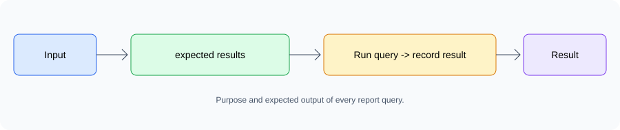

# Question 4 – Expected Result of Every Query

Results were checked by running `setup.sql` and `reports.sql` on SQL Server 2025 Express. Screenshots are in [01-report-queries](../01-report-queries/).

| Query | Purpose | Expected result |
|---|---|---|
| [Q1](../01-report-queries/Q1_top5_products_by_revenue.sql) | Top 5 products by revenue | 5 rows: Smart Watch 13,996; Mixer Grinder 9,897; Running Shoes 8,796; Basmati Rice 6,450; Bluetooth Speaker 5,996 |
| [Q2](../01-report-queries/Q2_month_wise_sales.sql) | Month-wise sales | 4 rows (Aug–Nov 2026); October is highest: 7 orders, 24,921 |
| [Q3](../01-report-queries/Q3_customers_more_than_3_orders.sql) | Customers with more than three orders (HAVING) | 3 rows: Arun Prakash (5), Karthik Raja (4), Rahul Sharma (4) |
| [Q4](../01-report-queries/Q4_avg_basket_value_per_city.sql) | Average basket value per city | 4 rows: Chennai 2,961.88 highest, Mumbai 2,296.25 lowest |
| [Q5](../01-report-queries/Q5_orders_without_payment.sql) | Orders without payment (LEFT JOIN) | 3 rows: orders 21, 23, 24 |
| [Q6](../01-report-queries/Q6_customers_with_no_orders.sql) | Customers with no orders | 2 rows: Sanjay Gupta, Nithya Ramesh |
| [Q7](../01-report-queries/Q7_category_revenue_share.sql) | Product-category revenue share | 5 rows totalling 100%; Electronics 42.43% |
| [Q8](../01-report-queries/Q8_highest_sales_day.sql) | Day with the highest sales | 1 row: 20 Oct 2026 (Tuesday), 3 orders, 13,985 |

## Approach

