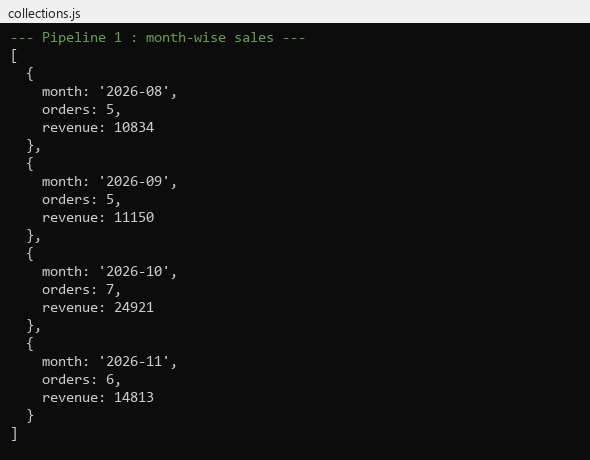
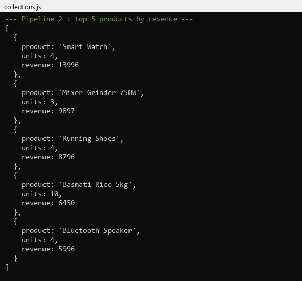
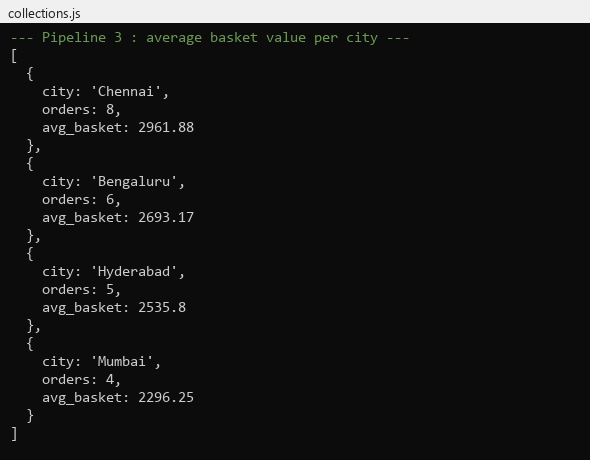

# Task 5 – MongoDB Aggregation Pipelines

The same 24 orders are stored in a MongoDB `orders` collection (one document per order, items embedded). Each pipeline uses `$match`, `$group` and `$sort`, and the results match SQL queries Q2, Q1 and Q4.

## Input

- [sales_pipelines.js](sales_pipelines.js) – run with `mongosh sales_pipelines.js`

## Output

**Pipeline 1 – Month-wise sales (same as Q2)**

**Pipeline 2 – Top 5 products (same as Q1)**

**Pipeline 3 – Average basket value per city (same as Q4)**

