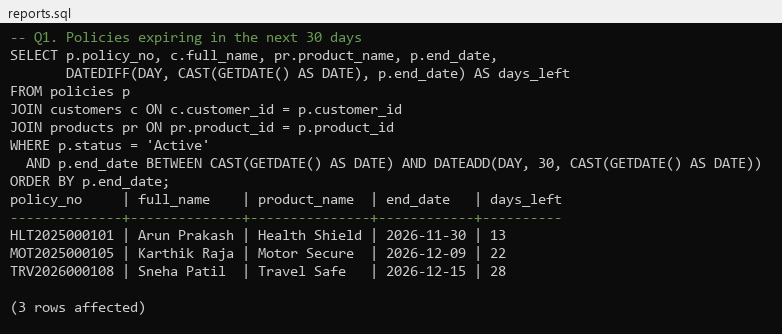
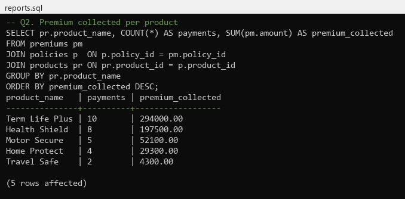
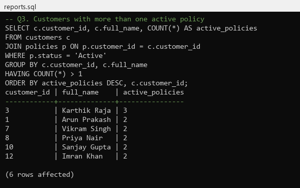
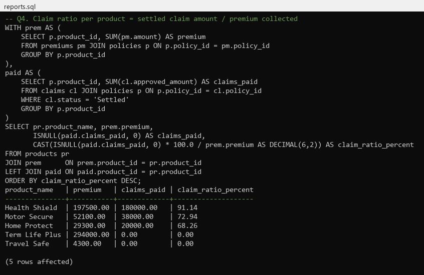
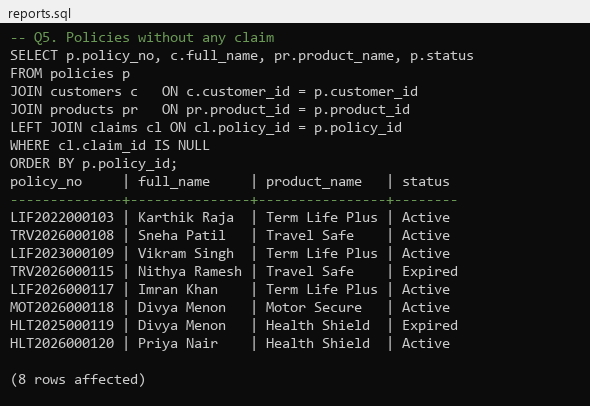
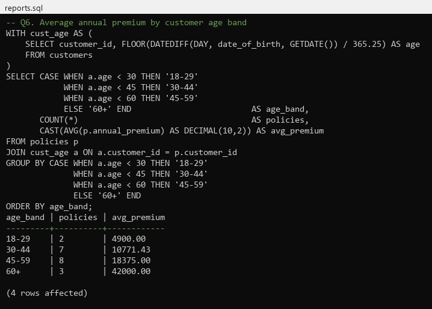
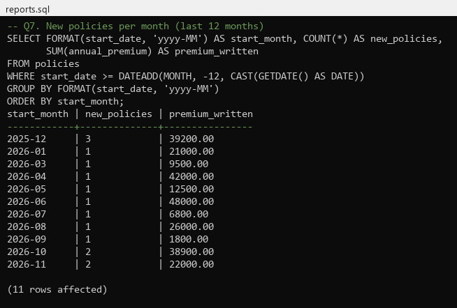
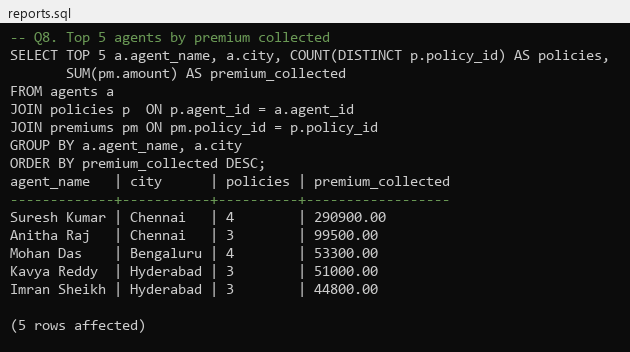
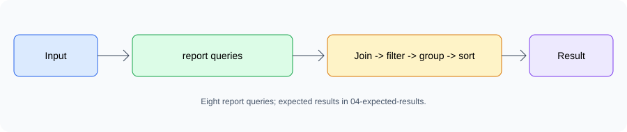

# Question 1 – Report Queries

Date-based reports use `GETDATE()`; the results shown are as of 17 Nov 2026.

| Query | Report |
|---|---|
| [Q1_policies_expiring_30_days.sql](Q1_policies_expiring_30_days.sql) | Policies expiring in the next 30 days |
| [Q2_premium_per_product.sql](Q2_premium_per_product.sql) | Premium collected per product |
| [Q3_customers_more_than_1_active_policy.sql](Q3_customers_more_than_1_active_policy.sql) | Customers with more than one active policy |
| [Q4_claim_ratio_per_product.sql](Q4_claim_ratio_per_product.sql) | Claim ratio per product |
| [Q5_policies_without_claims.sql](Q5_policies_without_claims.sql) | Policies without claims |
| [Q6_avg_premium_by_age_band.sql](Q6_avg_premium_by_age_band.sql) | Average premium by age band |
| [Q7_monthly_new_policies.sql](Q7_monthly_new_policies.sql) | Monthly new policies (last 12 months) |
| [Q8_top5_agents_by_premium.sql](Q8_top5_agents_by_premium.sql) | Top 5 agents by premium |

## Output

Full text output: [output.txt](output.txt)

**Q1. Policies expiring in the next 30 days**

**Q2. Premium collected per product**

**Q3. Customers with more than one active policy**

**Q4. Claim ratio per product**

**Q5. Policies without claims**

**Q6. Average premium by age band**

**Q7. Monthly new policies (last 12 months)**

**Q8. Top 5 agents by premium**

## Approach

