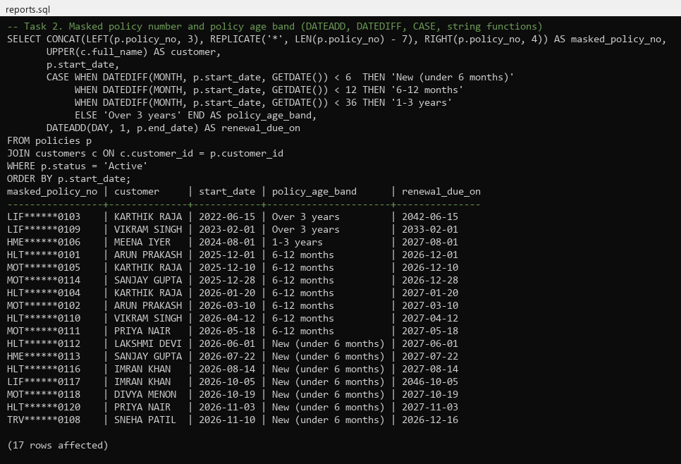

# Task 2 – Policy age bands and masked policy numbers (DATEADD, DATEDIFF, CASE, string functions)

The policy number is masked with LEFT, REPLICATE and RIGHT (e.g. `HLT******0101`). CASE with DATEDIFF gives the policy age band, and DATEADD gives the renewal date. Expected: 17 active policies.

## Input

- [policy_age_and_masking.sql](policy_age_and_masking.sql)

## Output

