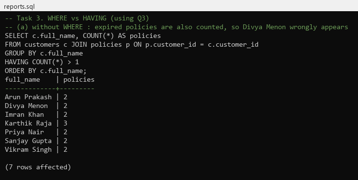
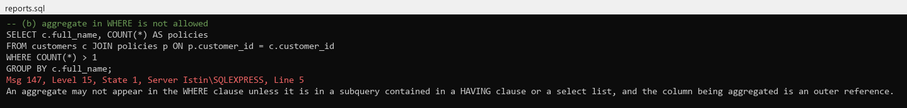
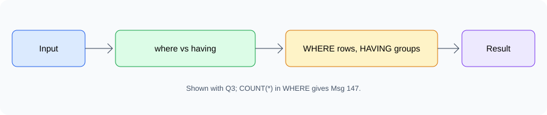

# Question 3 – WHERE vs HAVING

Explained with Q3 (customers with more than one active policy):

- **WHERE** filters rows **before** grouping: `WHERE p.status = 'Active'` removes expired policies first.
- **HAVING** filters groups **after** GROUP BY and can use aggregates: `HAVING COUNT(*) > 1`.
- Without the WHERE, expired policies are counted too and Divya Menon (1 active + 1 expired) wrongly appears – 7 rows instead of 6.
- An aggregate in WHERE is not allowed: SQL Server returns Msg 147.

## Query files

- [having_without_where.sql](having_without_where.sql)
- [aggregate_in_where_error.sql](aggregate_in_where_error.sql)

## Output

Full text output: [output.txt](output.txt)

## Approach

