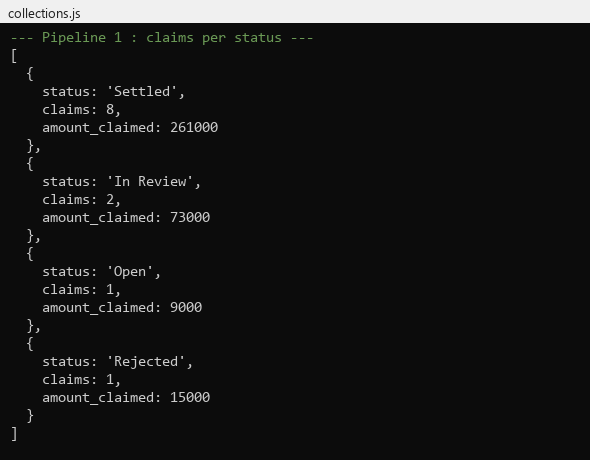
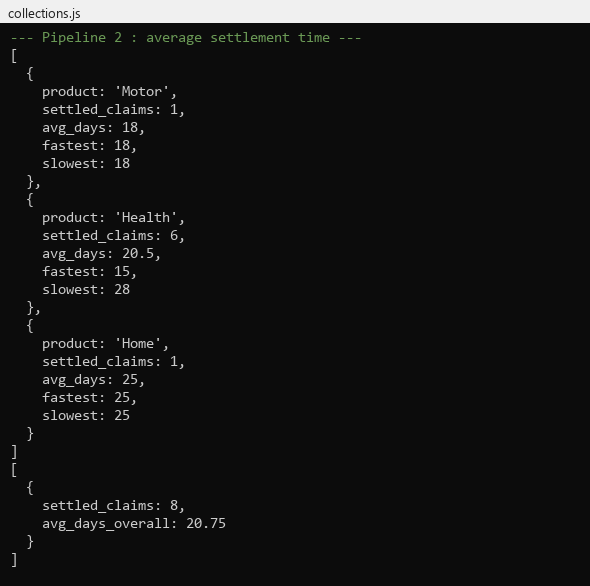
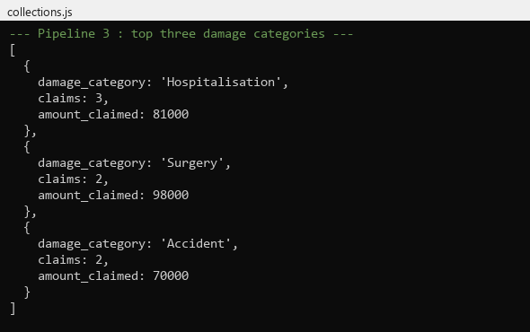

# Task 5 – MongoDB Aggregation Pipelines

Each claim is one document in `claims_notes`. Fields change by claim type: hospital for health, garage and FIR number for motor, surveyor for home. Each pipeline uses `$match`, `$group` and `$sort`.

## Input

- [claims_pipelines.js](claims_pipelines.js) – run with `mongosh claims_pipelines.js`

## Output

**Pipeline 1 – Claims per status**

**Pipeline 2 – Average settlement time (overall 20.75 days)**

**Pipeline 3 – Top three damage categories**

