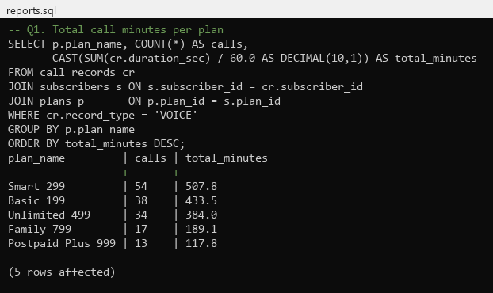
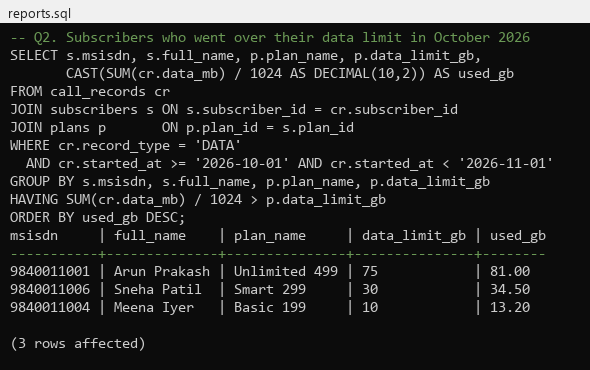
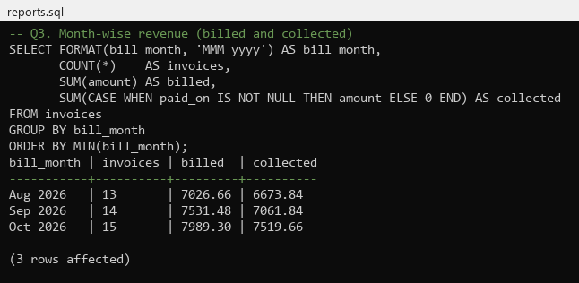
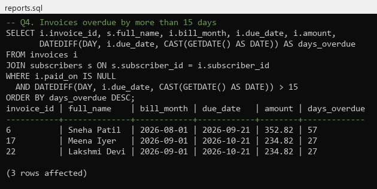
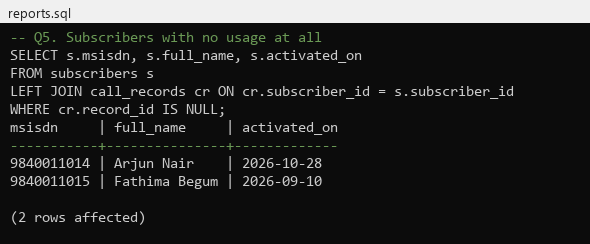
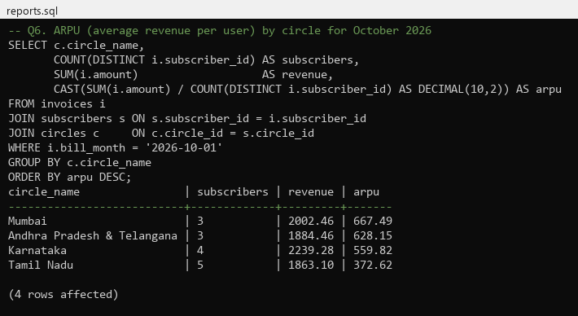
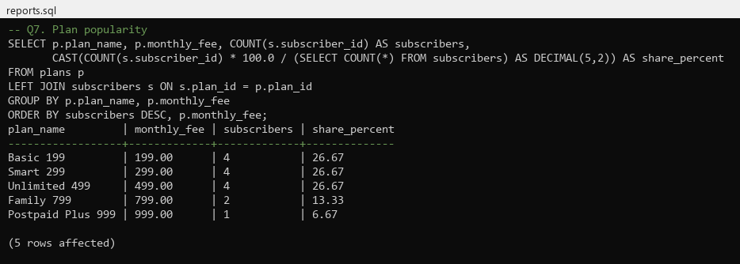
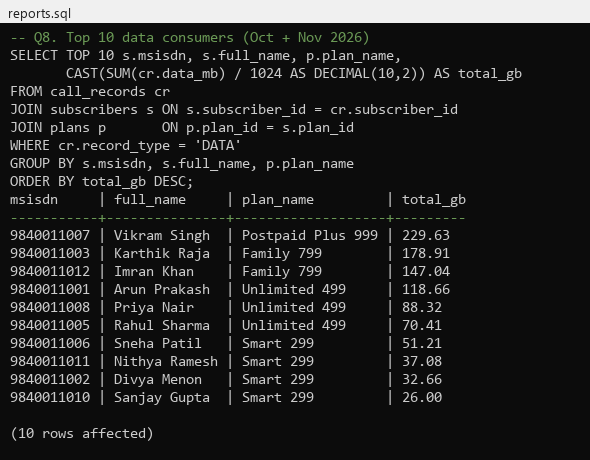

# Task 1 – Report Queries

Usage covers 1 Oct – 15 Nov 2026 and invoices cover Aug – Oct 2026. Date-based results are as of 17 Nov 2026.

| Query | Report |
|---|---|
| [Q1_call_minutes_per_plan.sql](Q1_call_minutes_per_plan.sql) | Total call minutes per plan |
| [Q2_subscribers_over_data_limit.sql](Q2_subscribers_over_data_limit.sql) | Subscribers exceeding their data limit (Oct 2026) |
| [Q3_month_wise_revenue.sql](Q3_month_wise_revenue.sql) | Month-wise revenue (billed and collected) |
| [Q4_invoices_overdue_15_days.sql](Q4_invoices_overdue_15_days.sql) | Invoices overdue by more than 15 days |
| [Q5_subscribers_with_no_usage.sql](Q5_subscribers_with_no_usage.sql) | Subscribers with no usage |
| [Q6_arpu_by_circle.sql](Q6_arpu_by_circle.sql) | ARPU by circle (Oct 2026) |
| [Q7_plan_popularity.sql](Q7_plan_popularity.sql) | Plan popularity |
| [Q8_top10_data_consumers.sql](Q8_top10_data_consumers.sql) | Top 10 data consumers |

## Output

**Q1. Total call minutes per plan**

**Q2. Subscribers exceeding their data limit (Oct 2026)**

**Q3. Month-wise revenue (billed and collected)**

**Q4. Invoices overdue by more than 15 days**

**Q5. Subscribers with no usage**

**Q6. ARPU by circle (Oct 2026)**

**Q7. Plan popularity**

**Q8. Top 10 data consumers**

