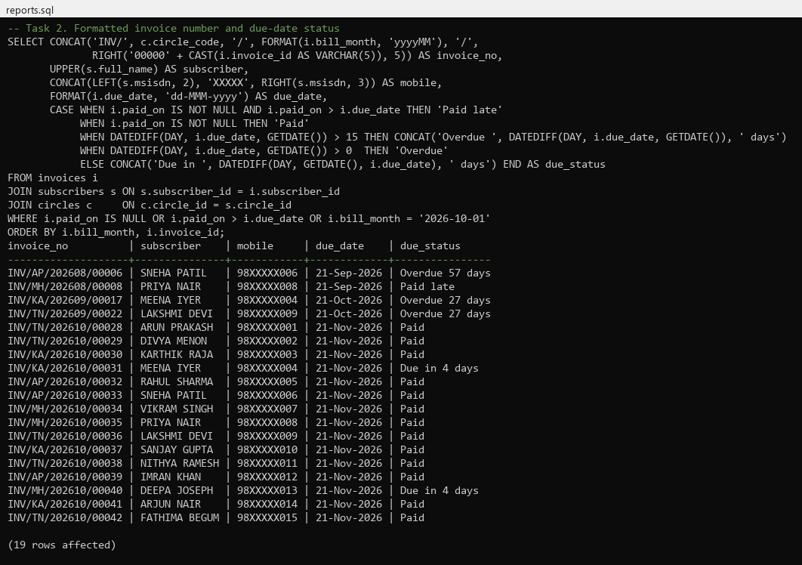

# Task 2 – Invoice number format and due-date status

Invoice number built with CONCAT, FORMAT and RIGHT as `INV/circle/yyyyMM/00000`; mobile masked with LEFT and RIGHT; status from CASE and DATEDIFF on the due date (Paid, Paid late, Overdue n days, Due in n days). Expected: 19 rows.

## Input

- [invoice_format_due_status.sql](invoice_format_due_status.sql)

## Output

