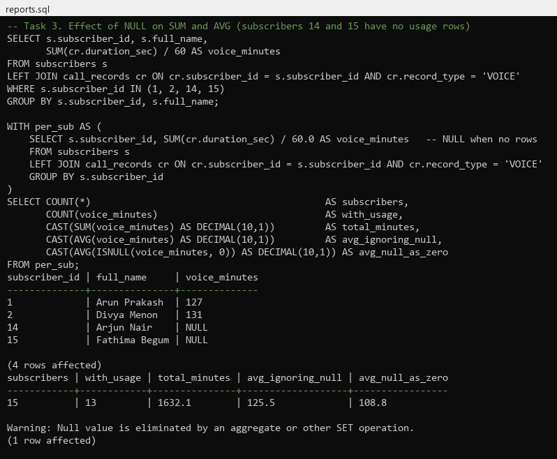
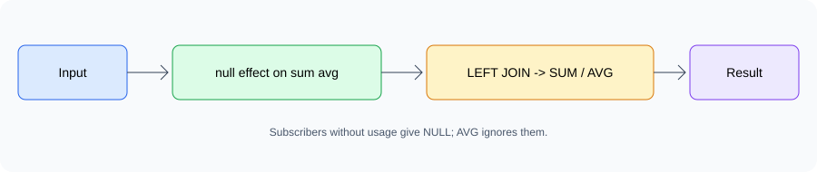

# Question 3 – Effect of NULL on SUM and AVG

Arjun Nair and Fathima Begum have no call rows, so after a LEFT JOIN their SUM is **NULL**, not 0.

- `COUNT(voice_minutes)` is 13 while `COUNT(*)` is 15 – the 2 NULLs are skipped.
- `AVG` ignores NULLs: 1632.1 / 13 = **125.5** minutes.
- `AVG(ISNULL(voice_minutes, 0))` divides by 15 = **108.8**, the true average per subscriber.

## Query files

- [null_effect_sum_avg.sql](null_effect_sum_avg.sql)

## Output

Full text output: [output.txt](output.txt)

## Approach

