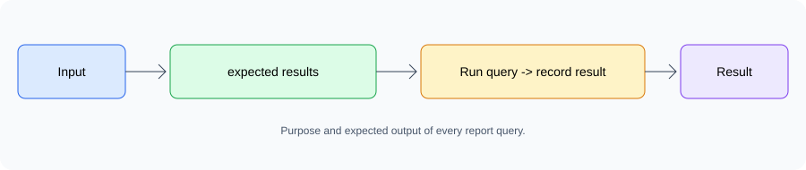

# Question 4 – Expected Result of Every Query

Results were checked by running `setup.sql` and `reports.sql` on SQL Server 2025 Express. Screenshots are in [01-report-queries](../01-report-queries/).

| Query | Purpose | Expected result |
|---|---|---|
| [Q1](../01-report-queries/Q1_call_minutes_per_plan.sql) | Total call minutes per plan | 5 rows: Smart 299 highest with 507.8 minutes |
| [Q2](../01-report-queries/Q2_subscribers_over_data_limit.sql) | Subscribers exceeding their data limit (Oct 2026) | 3 rows: Arun 81/75 GB, Sneha 34.5/30 GB, Meena 13.2/10 GB |
| [Q3](../01-report-queries/Q3_month_wise_revenue.sql) | Month-wise revenue (billed and collected) | 3 rows (Aug–Oct); October billed 7,989.30, collected 7,519.66 |
| [Q4](../01-report-queries/Q4_invoices_overdue_15_days.sql) | Invoices overdue by more than 15 days | 3 rows: invoice 6 (57 days), 17 and 22 (27 days) |
| [Q5](../01-report-queries/Q5_subscribers_with_no_usage.sql) | Subscribers with no usage | 2 rows: Arjun Nair, Fathima Begum |
| [Q6](../01-report-queries/Q6_arpu_by_circle.sql) | ARPU by circle (Oct 2026) | 4 rows: Mumbai 667.49 highest, Tamil Nadu 372.62 lowest |
| [Q7](../01-report-queries/Q7_plan_popularity.sql) | Plan popularity | 5 rows: Basic, Smart and Unlimited tied at 4 subscribers (26.67%) |
| [Q8](../01-report-queries/Q8_top10_data_consumers.sql) | Top 10 data consumers | 10 rows: Vikram Singh first with 229.63 GB |

## Approach

