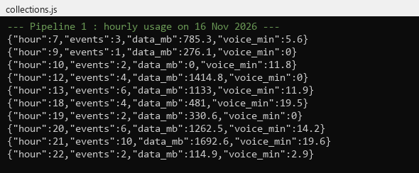
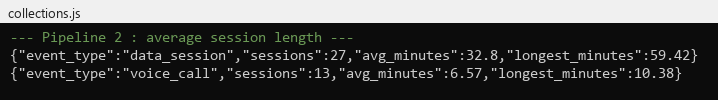
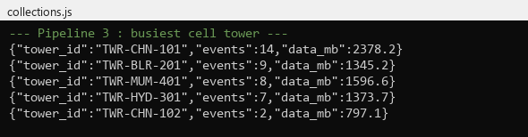

# Task 5 – MongoDB Aggregation Pipelines

40 network events from 16 Nov 2026 are stored in `usage_events`. Data sessions have data_mb and an app; voice calls have the called number. Each pipeline uses `$match` on the day, then `$group` and `$sort`.

## Input

- [usage_pipelines.js](usage_pipelines.js) – run with `mongosh usage_pipelines.js`

## Output

**Pipeline 1 – Hourly usage (21:00 is the peak hour)**

**Pipeline 2 – Average session length**

**Pipeline 3 – Busiest cell tower (TWR-CHN-101)**

